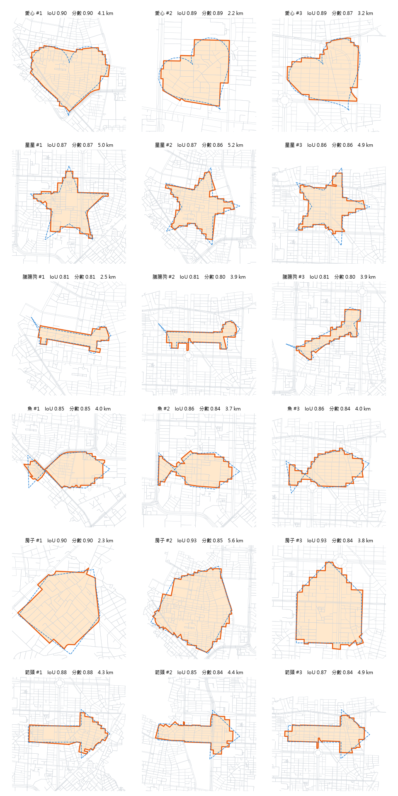
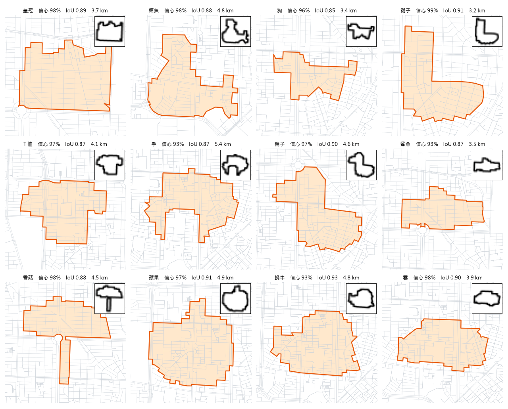
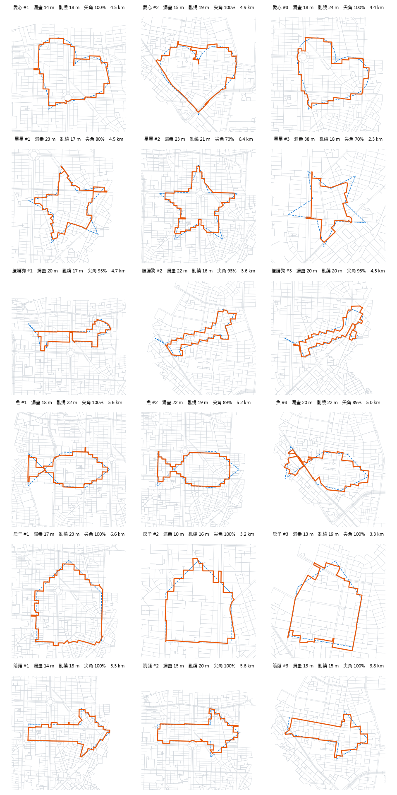
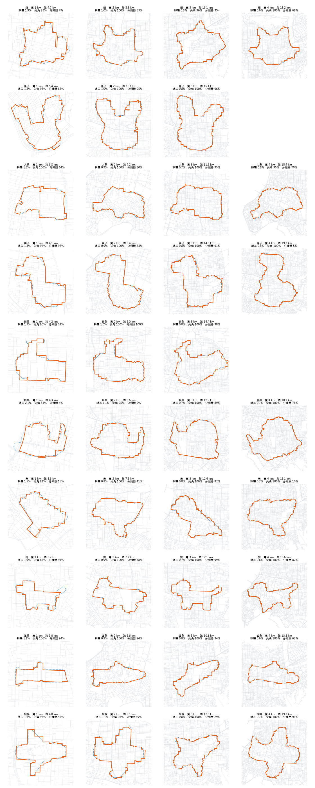
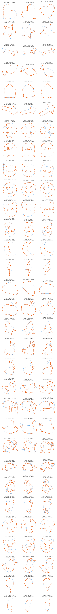

# 🗺️ City Shapes：城市街廓裡藏了什麼圖案？

給一個圖案（愛心、星星、臘腸狗…），在城市的街道網路裡自動找出**最像它、而且跑得出來**的封閉路線。是 [雙北 GPS Art Studio](https://github.com/zzzixun/gps-art) 的研究延伸。


<sub>大安區：橘線是路線（全程沿街道），藍色虛線是原圖案</sub>

## 方法：用「面」貼合，而不是用「線」貼合

一般 GPS Art 工具是把圖案的**線條**吸附到最近的街道上，常常出現斷線、折返、斜穿街廓。這裡改用**區域**的角度：

1. 把行政區的街道切成**街廓**（被街道圍起來的區塊）
2. 把圖案以「位置 × 大小 × 角度」擺到地圖上
3. 選出一半以上面積落在圖案裡的街廓，合併成一塊
4. 這塊的**外輪廓全部沿著街道**，所以必定是一條跑得出來的封閉路線
5. 評分 = **IoU**（合併區塊與圖案的交集 ÷ 聯集）− **鋸齒懲罰**（路線比圖案輪廓長太多，代表一直鑽小巷轉彎）

搜尋分兩階段：先在 10 m 網格上粗搜約 2 萬種擺法（只算 IoU，用街廓編號網格＋`bincount`，每種擺法約 0.5 ms），挑出位置互不重疊的前 8 名，再用完整評分做隨機爬山微調，取前三。

這個想法和我的碩士論文（Chan–Vese 主動輪廓）相通：都是讓一條封閉曲線在「貼合目標」與「輪廓平滑」之間取得平衡，只是這裡的曲線只能走在街道上。

## 結果

| 行政區 | 街廓數 | 每個圖案的搜尋時間 | IoU（前三名） | 路線長度 |
|---|---|---|---|---|
| 大安區 | 1,841 | 12–21 秒 | 0.81–0.93 | 2–6 km |
| 信義區 | 1,056 | 8–14 秒 | 0.75–0.93 | 2–5 km |

- 路線每 10 m 取樣檢查，離最近街道的距離中位數 0.1 m、95% 在 2 m 內，沒有任何一點超過 20 m
- 在一般筆電（i5-7300HQ、無 GPU）上，一個行政區跑完 6 個圖案約 2 分鐘

[信義區結果](out/xinyi/gallery.png)

## 第二階段：讓分類器當評審

IoU 高不代表「看得出是什麼」。把上面用手畫範本找到的路線，交給一個用 Quick, Draw! 訓練的分類器看，有對應類別的 24 條（星星、臘腸狗、魚、房子 × 兩區 × 前三名）**只認對 13 條（54%）**。所以改成直接以「分類器認不認得出來」為目標：


<sub>右上角小圖是分類器實際看到的 28×28 圖</sub>

1. **分類器**（`train.py`）：Google [Quick, Draw!](https://quickdraw.withgoogle.com/data) 24 類（魚、貓、狗、香菇、襪子、皇冠…），每類 12,000 張，約 40 萬參數的小 CNN，CPU 訓練約 30 分鐘
2. **縮小風格差異**：手繪圖是隨手的線條，路線是一圈方方正正的鋸齒。訓練時 1/3 原圖、1/3 轉成「只剩外輪廓」、1/3 轉成「方塊化外輪廓」
3. **範本從資料來**（`discover.py`）：每類自動挑 5 張「只看外輪廓也認得」的手繪圖當範本，用上面的街廓貼合找位置，再以 0.7×分類器信心 + 0.3×IoU − 鋸齒懲罰微調

| 測試資料（24 類，隨機猜 4%） | 正確率 |
|---|---|
| 原始手繪圖 | 86% |
| 只剩外輪廓 | 77% |
| 外輪廓再方塊化成 7×7 | 54% |

**驗證（`validate.py`）**：分類器信心是被直接最佳化的，一定偏高，所以另外做了兩個檢查：

- **抖動**：路線圖小幅旋轉 ±10°、縮放 ±10%、改線寬後重新分類。平均信心從 96% 降到 85%，但 92% 以上的抖動版本仍被認成同一類（大安區的蝸牛最不穩，只剩 67%）。代表大多數結果不是剛好騙過模型的鋸齒
- **對照組**：隨機橢圓在城市裡圈出的普通街廓塊，分類器最高信心中位數只有 32%，超過 90% 的只有 2.5%，而且幾乎都是「雲」。所以「雲」的結果不可信，其他類別的高信心有意義

兩區 24 類各約 20 秒（[信義區結果](out/xinyi/discover.png)）。

## 第三階段：改用「線」描圖案

人眼看第一、二階段的結果，還是不太像。查了相關研究後發現原因：

- 人靠**尖角、凹口、突出的小部位**認圖（耳朵、尾巴、鰭）。[Batik 等人 2022](https://pmc.ncbi.nlm.nih.gov/articles/PMC10946624/) 的受試者實驗裡，熊的輪廓 60% 的人看得出來，但熊的牙齒沒有任何人看出來，因為太小、點太少。用街廓「面積」貼合，會把這些小部位填平
- 直接最佳化分類器信心，會找到「分類器覺得像、人看不出來」的圖（[Nguyen 等人 2015](https://arxiv.org/abs/1412.1897)）
- [Waschk & Krüger 2019](https://link.springer.com/content/pdf/10.1007/s41095-019-0146-z.pdf) 等 GPS Art 研究都是沿街道描「線」，細的部位可以用一條街表現

所以 `lines.py` 改成最簡單的線條版：

1. **粗搜擺法**：街道畫成 5 m 網格做距離轉換，查圖案取樣點離最近道路的平均距離。每種大小（0.8–2 km）分開挑前 5 名，避免小尺寸因為絕對距離小而全部勝出
2. **沿街道找路**（Waschk 的簡化版）：圖案上每 150 m 一個路標，相鄰路標之間跑 Dijkstra，路段成本 = 長度 ×（1 + (離圖案距離 / 25 m)²），越偏離圖案越貴
3. **雙向評分**：漏畫（圖案 → 路線的平均距離）、亂繞（路線 → 圖案的平均距離）、尖角保留率（轉角超過 40° 的頂點有幾成在路線 3% 圖寬以內），再扣「路線比圖案周長長 25% 以上」（代表有來回重跑）


<sub>橘線是路線，藍色虛線是原圖案</sub>

- 每個圖案約 3 秒（比面積版快 5 倍以上），漏畫與亂繞平均 10–37 m
- 用第二階段的分類器當**獨立評審**（這次沒有拿它來最佳化）：有對應類別的路線，面積版認對 13/24（54%），線條版認對 15/23（65%）。分類器本身不可靠，主要還是靠人眼判斷
- 已知問題：比一個街廓還細的部位（臘腸狗的腳）只能跑進去再折返；路標吸附到旁邊的節點時偶爾留下短短的死巷分岔

### 實驗：動物要畫多大才像？

Quick, Draw! 的 10 種動物外輪廓（貓、兔子、大象、鴨子、鯨魚、蝸牛、鳥、狗、鯊魚、飛機），在整個臺北市分別限制圖寬 1 / 2 / 3 / 4 km 找最好的路線（`animals.py`）：



| 圖寬 | 相對誤差（平均偏差 ÷ 圖寬） | 尖角保留 | 平均跑步距離 | 分類器認對 |
|---|---|---|---|---|
| 1 km | 1.6% | 92% | 4.0 km | 7/10 |
| 2 km | 1.0% | 99% | 8.3 km | 9/10 |
| 3 km | 0.8% | 100% | 12.9 km | 9/10 |
| 4 km | 0.6% | 99% | 16.8 km | 6/8 |

- **1 → 2 km 進步最多**（誤差減半，兔子耳朵、鴨子嘴巴、飛機機翼都是 2 km 才出現）；之後效益遞減，3 km 以上多跑很多距離但幾乎不會更像
- 原因：路線的絕對偏差大約固定（街廓 ≈ 100 m），圖越大相對誤差越小；但到 2–3 km 時，路線已經很貼圖案，**剩下的限制是範本本身**——28×28 手繪剪影太粗糙，又沒有眼睛等內部線條
- 4 km 有兩種動物在臺北市內放不下（找不到完整的路線）
- 分類器在不同大小間的判斷跳動很大（例如同一隻鴨子 3 km 認得、4 km 猜西洋梨），再次說明它不適合當最終評審

[信義區結果](out/xinyi/lines.png)

### 全大台北掃描：每個圖案最像的地方

用 [GPS Art](https://zzzixun.github.io/gps-art/) 網頁版的「指定範圍自動生成」（多筆畫描線、沿街道找路、校正距離），在台北盆地每 2.5 km 放一個中心點（共 132 個、半徑 2 km、目標 10 km），31 個內建範本（包括坐著的貓、兔子、小鴨、大象、鯨魚、蝸牛、烏龜、企鵝等 8 隻整隻動物，以及珍珠奶茶、蘑菇、豬、小雞、氣球、台灣島 6 個 emoji 風格圖案）各取全區最像、彼此相距 1.5 km 以上的前 3 名（`scan_report.py`）：



- **松山、中山、大安最好畫**：棋盤狀的街道又密又直，17 個基本圖案裡有 13 個的第 1 名在這三區；永和、板橋、三重適合笑臉、兔子、月亮這類圓形圖案
- 最容易畫像的是愛心、蘋果、熊、月亮（漏畫 14–17 m），最難的是聖誕樹、星星：斜的尖角在棋盤狀的街道上容易被磨圓（聖誕樹的尖角只保留 73–80%）
- 整隻動物裡，兔子、烏龜、大象最像（分數 0.8–1.3）；蝸牛的螺旋最難，線距太近的地方會被街道合併
- emoji 風格的圖案（輪廓圓、特徵少）普遍好畫：氣球、珍珠奶茶分數 0.8，蘑菇 1.1
- 鹿港市區另外掃了 9 個點（`out/lukang/`）：街道比台北稀疏，月亮、兔子、愛心、氣球、台灣島還畫得像，尖角多或細長的圖案（星星、閃電、鹿、章魚）畫不出來
- 結果已放進 GPS Art 的「熱門路線」分頁，可以直接載入

## 使用

```bash
python -m venv .venv && .venv\Scripts\activate
pip install osmnx matplotlib scikit-image
pip install torch --index-url https://download.pytorch.org/whl/cpu   # CPU 版約 1 GB

python fetch.py "Da'an District, Taipei, Taiwan" daan   # 下載路網、切街廓（約 1 分鐘）
python shapes.py daan                                    # 手畫範本搜尋（約 2 分鐘）

# 第二階段：先下載 Quick, Draw! 24 類（共 2.6 GB）到 cache/quickdraw/<類別>.npy
#   https://storage.googleapis.com/quickdraw_dataset/full/numpy_bitmap/<類別>.npy
python train.py              # 訓練分類器（約 30 分鐘，已附 models/qd_cnn.pt 可略過）
python discover.py daan      # 每類找最像的路線（約 10 分鐘）
python validate.py daan      # 抖動與對照組檢查

python lines.py daan         # 第三階段：用線描（約 20 秒，不需要 PyTorch）
python fetch.py "Taipei, Taiwan" taipei && python animals.py taipei   # 動物 × 圖寬實驗（約 25 分鐘）
python scan_report.py results.jsonl   # 整理全大台北掃描（掃描本身在瀏覽器跑 GPS Art，約 20 分鐘）
```

輸出在 `out/<名稱>/`：GPX（可直接匯入 GPS Art、Strava、Garmin）、預覽圖 `gallery.png` / `discover.png`、`results.json` / `discover.json`。

## 下一步

- **可辨識度實驗**：找人看路線猜圖案，比較 IoU、分類器信心和人眼判斷，看哪個指標最接近人
- **更多「不是圖案」的訓練資料**：把隨機街廓塊當成第 25 類「什麼都不像」，讓「雲」這種容易誤判的類別也能用
- **畫內部線條**：目前只能畫一圈外輪廓，加入折返路段才畫得出眼睛、翅膀
- 整合回 GPS Art 網頁版的「範本」分頁

## 已知限制

- 只能產生「外輪廓」型的圖案（一圈），畫不出眼睛、內部線條
- 很大的公園、校園不算街廓（面積上限 15 萬 m²），圖案不會穿過它們
- 合併街廓時會先外擴再內縮 12 m 補起分隔道路的縫，所以路線偶爾會在分隔島附近偏離 1–2 m

## 授權

© 2026 尤梓薰（Yu Tzu-Hsun），以 [GPL v3.0](https://www.gnu.org/licenses/gpl-3.0.html) 授權。地圖資料 © OpenStreetMap contributors（ODbL）。
